<p align="center">
    <a href="https://devinthehood.com"></a>
</p>

<p align="center">
    <a href="https://opensource.org/licenses/MIT" target="_blank"></a>
</p>

MACOS-UTILS
===========
Visage
------

<p align="center">
    
</p>

Visage gives a face to the voice of the AI you already talk to. Talk to Claude
in its voice mode, or to ChatGPT, and a hologram face floats on your desktop
and speaks with that voice: lips in sync, alive between sentences. It listens
while you speak, thinks once you have finished, then answers.

It costs nothing on top of the subscription you already have: no API key, no
server, no account. Visage never talks to the AI app. It only hears the sound
that app plays, and nothing leaves your Mac.

<p align="center">
    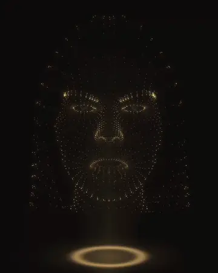
</p>

Requirements
------------

* **macOS 15+** (Sequoia). Built for Apple silicon and Intel. The Intel build
  compiles but has not yet been tried on an Intel Mac. If you run it on one,
  please say so in an issue.
* **Claude Desktop**, installed and signed in, for its
  [voice mode](https://support.claude.com/en/articles/11101966-use-voice-mode).
  The **ChatGPT** app works too, and so does any app that plays a voice, with
  no guarantee.
* **Command Line Tools** (`xcode-select --install`) to build it. Xcode is
  optional, and neither is needed for the download.

Sources
-------

Visage is far bigger than the other utilities, so it is split into modules
that can be read one at a time. Each one states its job at the top of its main
file.

| Path | Role |
| --- | --- |
| [Sources/AudioSource/](/data/sources/visage/Sources/AudioSource/) | Finds the AI app's audio processes, taps their sound, plays it back delayed |
| [Sources/VoiceAnalysis/](/data/sources/visage/Sources/VoiceAnalysis/) | Energy, pitch, formants, fricatives and closures, 100 times a second, with Accelerate |
| [Sources/FaceAnimation/](/data/sources/visage/Sources/FaceAnimation/) | The 52 ARKit face weights, the head and the gaze, frame by frame: speaking, listening, thinking |
| [Sources/HoloRenderer/](/data/sources/visage/Sources/HoloRenderer/) | The faces' glTF reader and the hologram, in Metal |
| [Sources/Shared/](/data/sources/visage/Sources/Shared/) | The host clock everything is timed on, the brand's geometry |
| [Sources/VisageApp/](/data/sources/visage/Sources/VisageApp/) | The app: menu bar, welcome, *Connect my AI*, settings, the face's window |
| [Resources/](/data/sources/visage/Resources/) | The ten faces, and the interface's English and French strings |
| [Tests/](/data/sources/visage/Tests/) | Swift Testing, one folder per module |
| [tools/faces/](/data/sources/visage/tools/faces/) | Rebuilds the faces with Blender (see *The faces*) |
| [brand/](/data/sources/visage/brand/) | The brand kit: code that writes the logos and draws the app icon |
| [pilot/](/data/sources/visage/pilot/) | The pilot that measured capture and delayed playback before the app was written |
| [docs/](/data/sources/visage/docs/) | The specification, the brand charter, the pilot's report |
| [Info.plist](/data/sources/visage/Info.plist) | Bundle metadata, and the reasons macOS shows when Visage asks for access |
| [build.sh](/data/sources/visage/build.sh) | Builds `Visage.app` without Xcode |
| [check.sh](/data/sources/visage/check.sh) | The gate: build, tests, format |

No third-party package: Swift and Apple's frameworks only.

Installation
------------

### Option A — from source

```shell
sh data/sources/visage/build.sh --install
```

The app lands in `/Applications/Visage.app`. Open it: the welcome screen comes
up (see *First launch*).

Flags:

| Flag | Effect |
| --- | --- |
| *(none)* | builds `build/Visage.app` for the current architecture |
| `--universal` | builds a fat binary (arm64 + x86_64) |
| `--install` | moves the result to `/Applications`, after asking a running copy to quit |
| `--tests` | builds the modules for testing and runs the tests |

As for [Awake](/data/doc/AWAKE.md), the script compiles with `swiftc`: each
module becomes a static library, then the app links them. It assembles the
bundle by hand, draws the icon, and signs the app ad hoc. There is no
SwiftPM manifest: with the Command Line Tools alone, SwiftPM could not even
link one.

Before a pull request that touches Visage, run its gate and read the count
of tests:

```shell
sh data/sources/visage/check.sh
```

### Option B — a release

The [Releases](https://github.com/jul6art/macos-utils/releases) page has
`Visage-<version>.zip`: one universal archive, for Apple silicon and Intel.

1. Download it and its `.sha256`, then check it:

   ```shell
   shasum -a 256 -c Visage-0.1.0.zip.sha256
   ```

2. Unzip it, and move **Visage** to **Applications**.
3. Open it. macOS refuses: the app is signed ad hoc, not notarized by Apple,
   so Gatekeeper cannot vouch for it. Click **Done**.
4. Open **System Settings** → **Privacy & Security**, scroll down to the
   message about Visage, click **Open Anyway**, and confirm. macOS remembers
   it: the next launches open normally.

The archive is built from the release's tag by
[data/sources/release.sh](/data/sources/release.sh), and the build is reproducible:
with the same Command Line Tools, building the tag yourself gives the same
archive, byte for byte, and the same checksum.

```shell
git checkout visage-v0.1.0
sh data/sources/release.sh visage    # prints the SHA-256 to compare
```

There is no updater: a new version is a new download that replaces the app.
macOS may then ask for the system audio permission again.

First launch
------------

### 1. The welcome

The first launch opens a welcome screen, large and in front. It asks for four
choices on one page: your AI, your face, where it shows, and where to find
Visage afterwards. Then click **Start**.

<p align="center">
    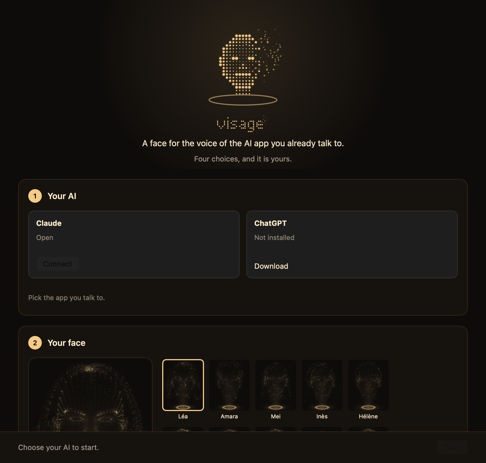
</p>

### 2. Choose Claude

In the welcome's first step, or later in *Connect my AI* from the menu bar, the
**Claude** card says whether Claude Desktop is installed and open. Click
**Connect**: Visage opens Claude if needed and connects to it. If Claude is
not installed, the card offers **Download**, which opens Anthropic's download
page in your browser. **ChatGPT** works the same way, and *Another app* lists
every app currently playing sound.

<p align="center">
    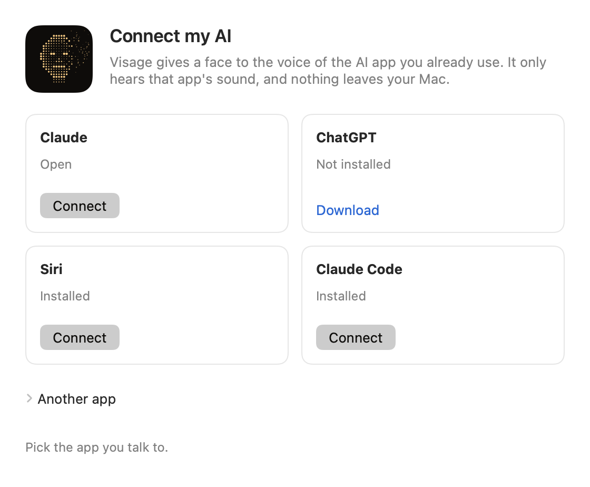
</p>

### 3. Allow system audio

macOS asks, once, whether Visage may record system audio: **allow it**.
That is how Visage hears the AI app. It hears that app only, keeps nothing
and records nothing (see *Privacy*).

If you dismissed the prompt, Visage says it cannot hear Claude yet. Click
**Open System Settings**, then turn Visage on under **Privacy & Security** →
**Screen & System Audio Recording** → *System Audio Recording Only*.

<p align="center">
    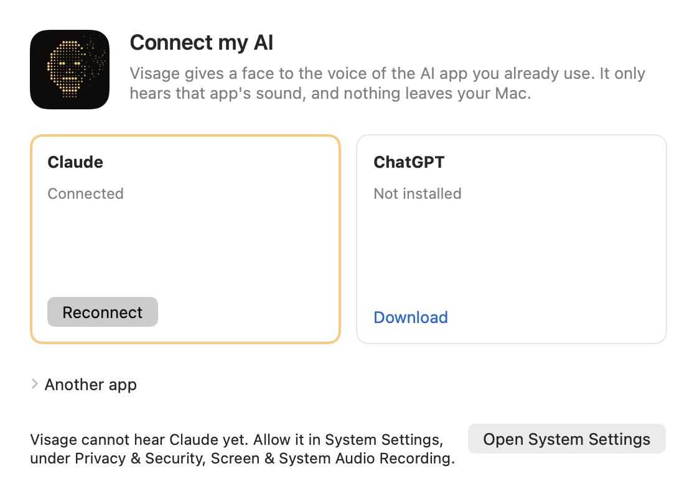
</p>

### 4. Start Claude's voice mode

Visage now says **Connected to Claude**. In Claude Desktop, start the
**voice mode** with the **sound-wave button at the bottom right** of its
window. Anthropic explains it in
[Use voice mode](https://support.claude.com/en/articles/11101966-use-voice-mode).

The voice mode is not the microphone button, which only dictates into the text
field. With dictation, the face still speaks when Claude reads its answer
aloud, but only the voice mode makes a conversation.

From then on, talk to Claude. The face listens while you speak, thinks once you
have finished, and speaks with Claude's voice.

<p align="center">
    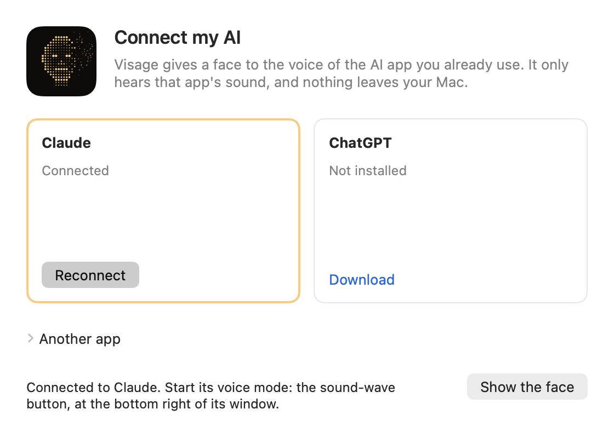
</p>

Visage remembers all of it. On the next launches it shows nothing more: it
reconnects to the same app, even after that app restarts, and puts the face
back as you left it.

### 5. The settings

Visage lives in the menu bar, top right of the screen, under its sign. Its menu
says whether it is connected, shows or hides the face, switches the face and
the window mode, connects to another AI, and opens **Settings…**. The same menu
opens with a right click on the face.

<p align="center">
    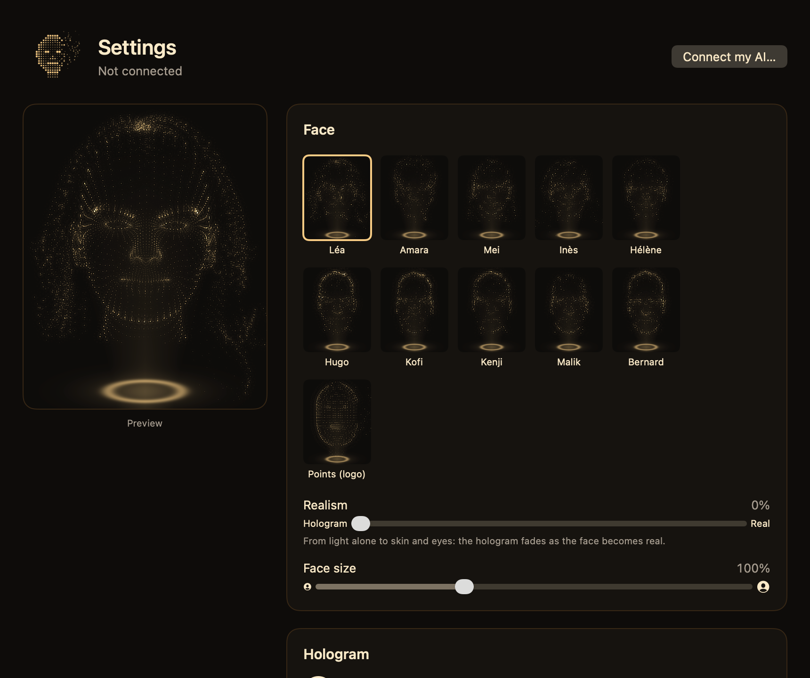
</p>

| Card | Setting | What it does |
| --- | --- | --- |
| **Face** | the grid | ten faces, and the logo's point head |
| | **Realism** | from a hologram of light (0 %) to skin and eyes (100 %) |
| | **Face size** | 50 to 200 % of the default window |
| **Hologram** | colour | Ember (the default), Azure, Mint, Rose or Ivory |
| | **Halo**, **Scanlines** | the glow around the light; the fine lines and the band that sweeps down the face |
| | **Plinth and beam**, **Flicker and glitches** | the projector under the face; the hologram's small accidents |
| **Conversation** | | whether your AI is listening to you right now |
| | **Hear me through the microphone** | off by default. While your AI listens to you, Visage reads how loud your voice is, and nothing else. The face then nods at your pauses and thinks once your sentence ends |
| **Camera** | **Follow me with the camera** | off by default. The gaze rests on you and follows you, and the head turns a little as you move |
| **Window** | **Floating** | the default: transparent, above every window, on every desktop |
| | **Classic** | a plain window with a title bar and a dark background, to share or record your screen |
| **Sync** | **Delay** | 150 ms by default (80 to 300): how long the voice waits so the face can read ahead |
| | **Anticipation** | 60 ms by default (0 to 120): how early the lips move before the sound |
| | **Lip offset** | 0 by default (−100 to 300 ms): for Bluetooth headphones, which play the sound later |

<p align="center">
    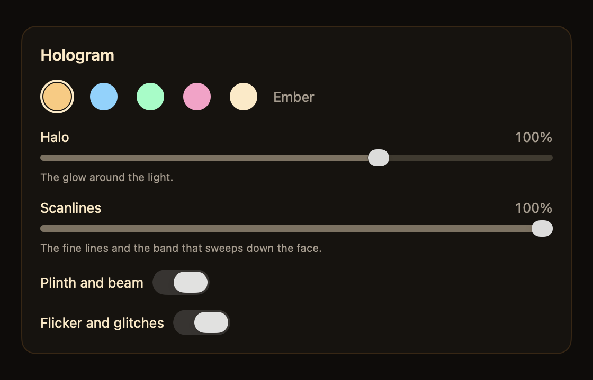
    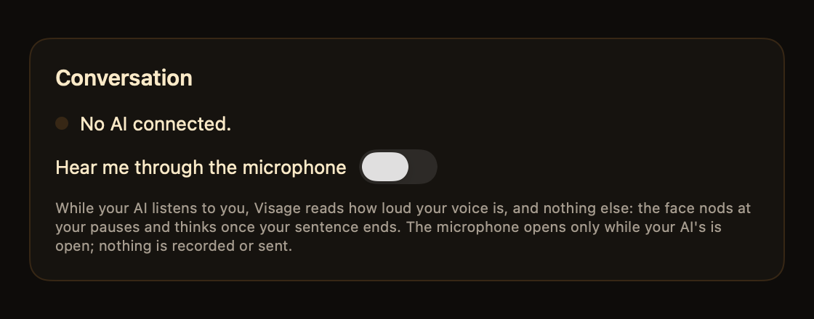
</p>
<p align="center">
    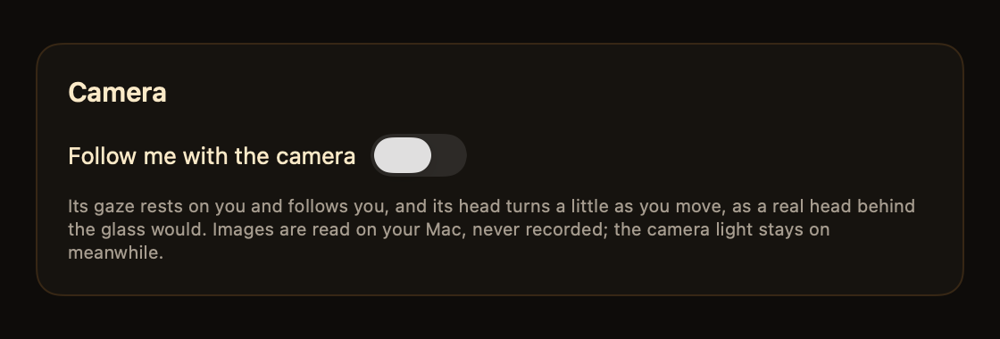
    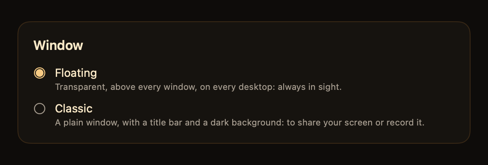
</p>
<p align="center">
    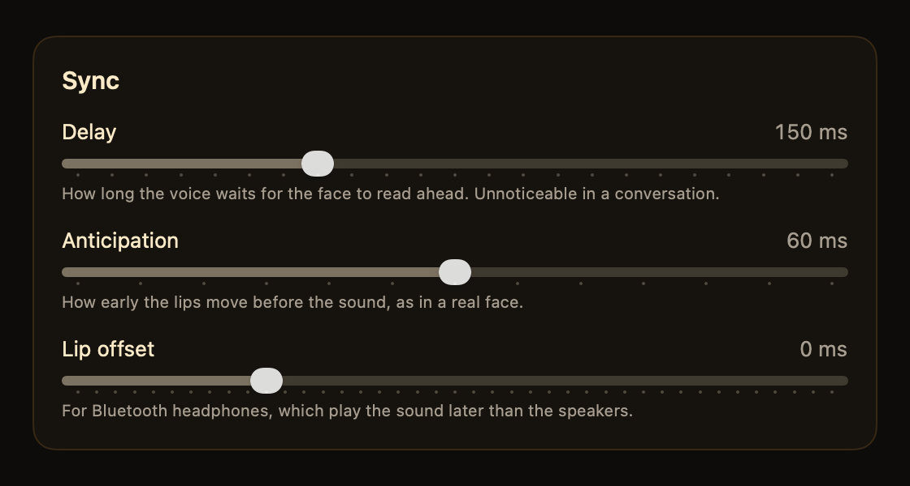
</p>

The faces
---------

Ten faces, five women and five men, invented, of different ages and origins:
Léa, Amara, Mei, Inès, Hélène, Hugo, Kofi, Kenji, Malik and Bernard. All of
them share one mesh, so one animation drives them all. The realism gauge takes
them from a hologram of light points to a lit face:

<p align="center">
    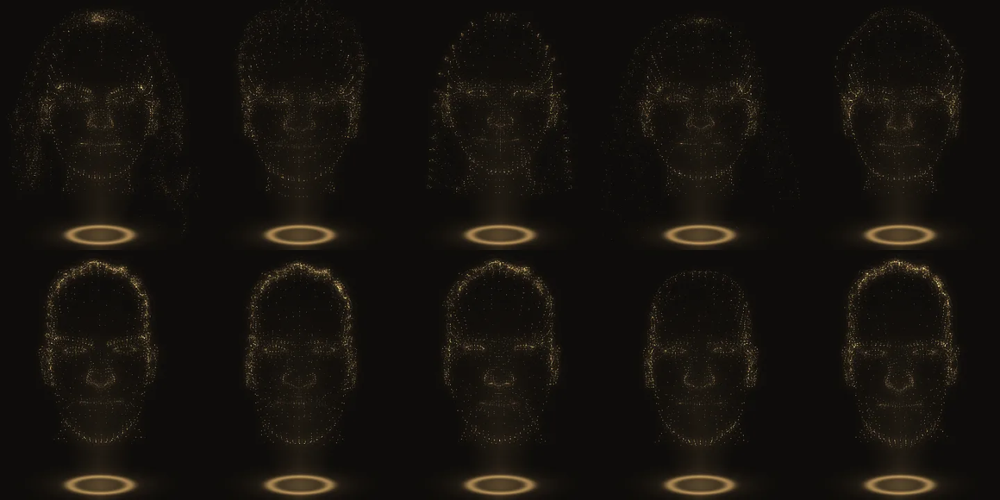
    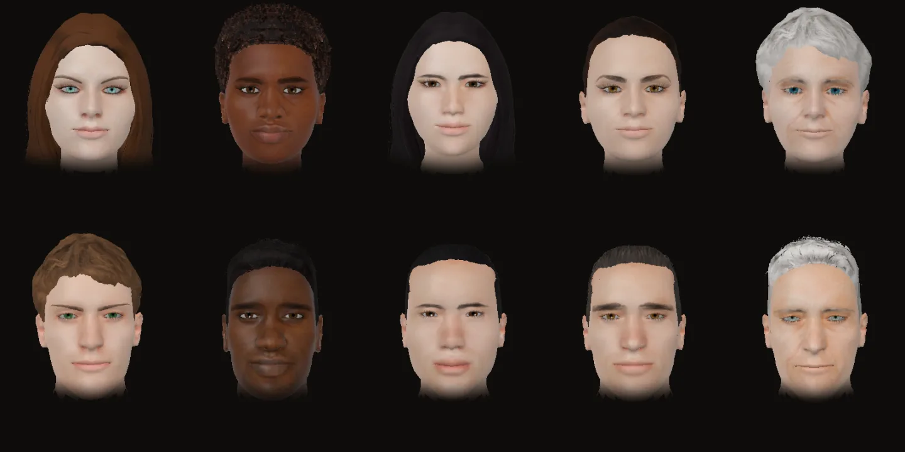
</p>

They come from MakeHuman, through its Blender extension
[MPFB](https://extensions.blender.org/add-ons/mpfb/) and the
[CC0 assets](https://static.makehumancommunity.org/about/license.html) it uses (skins, eyes, hair, and the
`faceunits01` pack of 52 ARKit face shapes). Everything the faces are made of
can be redistributed freely. [tools/faces/](/data/sources/visage/tools/faces/)
rebuilds them:

```shell
sh data/sources/visage/tools/faces/build.sh            # the ten faces
sh data/sources/visage/tools/faces/build.sh lea hugo   # only these
```

It needs Blender with MPFB and the MakeHuman assets, only to rebuild the faces:
the app itself never needs Blender. Each face is a set of values in
[presets.json](/data/sources/visage/tools/faces/presets.json): MakeHuman's
weighted targets, proportions, hair, brow and skin colours. Every clone of this
repository carries all ten, so a face's mesh stays under 3 MB and its textures
under 2.5 MB.

How it works
------------

```
 AI app (Claude Desktop or ChatGPT), voice mode
        │ that app's sound only, muted at the output while Visage taps it
        ▼
 ┌──────────────────────── Visage ─────────────────────────┐
 │  ring buffer, fixed delay ≈ 150 ms                      │
 │      │                                    │             │
 │      ▼ analysis, ahead of the sound       ▼             │
 │  energy, pitch, formants,           playback of the     │
 │  fricatives, closures               sound, delayed      │
 │      │                                    │             │
 │      ▼                                    │ speakers    │
 │  animation: 52 face weights,              │ or          │
 │  head, gaze, moments                      │ headphones  │
 │      │                                    │             │
 │      ▼                                    │             │
 │  Metal hologram ◀──── one clock ──────────┘             │
 └─────────────────────────────────────────────────────────┘
```

**The trick is the delay.** Visage mutes the AI app's own output, using a
per-process Core Audio tap, and plays the sound back itself about 150 ms
later. Meanwhile the analysis has already seen what comes next, so the lips can
form *before* the sound, as a real speaker's do, instead of always trailing
behind it, which the eye catches at once. In a conversation, 150 ms more before
the answer goes unnoticed.

**No model, no network.** The voice is analysed with plain signal processing:
energy and voicing, pitch (YIN), vowel formants (LPC), fricatives, lip and
tongue closures. It works the same in any language and takes a few percent of
one core. Each displayed frame is computed for the sample that will be heard
when that frame shows, Bluetooth latency included (*Lip offset*).

**Alive at rest.** Between sentences the face breathes, blinks, glances away
and comes back, drifts a little, and now and then shows a micro-expression,
never twice the same way. While you speak it listens, its gaze on you. Once
you stop it thinks: the gaze lifts, the lips press together.

**When the AI listens.** Core Audio says whether a process has its microphone
open, without any permission and without hearing it. Visage reads that four
times a second, so it knows when your AI listens to you.

**Safe to quit.** The tap is private: if Visage quits or crashes, the AI app's
sound comes back on its own.

The full design, with its measurements, is in the
[specification](/data/sources/visage/docs/specs.md).

Privacy
-------

* **Nothing is recorded, nothing is sent.** The AI app's sound passes through a
  buffer of about 150 ms, in memory, and on to your speakers. No sound, image or
  text is written anywhere.
* **No network access.** Visage opens no connection: the sources use no
  networking API. The *Download* links open in your browser.
* **It hears one app.** Only the AI app you chose, never your other apps.
  Visage cannot see the conversation: it never reads a text, an account or a
  token.
* **The microphone option** reads your voice's level and nothing else, only
  while your AI has its own microphone open. It closes three seconds after your
  AI's.
* **The camera option** finds where your face is, ten times a second, on the
  Mac. Images are never kept, and the camera light stays on meanwhile.

Each access is a macOS permission you grant, and can withdraw, in System
Settings → Privacy & Security.

What it touches on the machine
------------------------------

| What | Where |
| --- | --- |
| The app | `/Applications/Visage.app`, with `--install` |
| Settings | preference domain `com.devinthehood.visage`: the AI app, the face and every setting above |
| Permissions | *System Audio Recording*, and *Microphone* or *Camera* if you turn those options on |

No login item, no `LaunchAgents` entry, nothing else written. **Quit Visage**,
in its menu, stops everything and gives the AI app its sound back.

Removing it
-----------

```shell
rm -rf /Applications/Visage.app
defaults delete com.devinthehood.visage
tccutil reset All com.devinthehood.visage    # forget the permissions
```

The icon
--------

The icon is drawn by code, not stored as an image: `build.sh` runs
[brand/generate.sh](/data/sources/visage/brand/generate.sh) `--iconset`,
which renders every size from the brand's geometry, then packs them with
`iconutil`. The logos in [brand/](/data/sources/visage/brand/) are SVG
written by the same kit: change the kit, never the files.

Gatekeeper
----------

Visage is signed ad hoc, not notarized. Built on your Mac, it just runs.
Downloaded, or copied from another Mac, it is quarantined: allow it once with
**Open Anyway** (see *Option B*), or clear the flag in a terminal:

```shell
xattr -dr com.apple.quarantine /Applications/Visage.app
```

Troubleshooting
---------------

| Symptom | Fix |
| --- | --- |
| *"Apple could not verify Visage is free of malware"* | the download is not notarized: **System Settings** → **Privacy & Security** → **Open Anyway** (see *Option B*) |
| *"Visage cannot hear Claude yet"* | the system audio permission is missing: **Open System Settings**, then turn Visage on under *Screen & System Audio Recording* |
| Visage is allowed in System Settings, yet hears nothing | seen once, with no known cause: `tccutil reset AudioCapture com.devinthehood.visage`, relaunch Visage, allow it again |
| *"Connected to Claude"*, but the face never speaks | Claude is not speaking yet: start its **voice mode**, the sound-wave button at the bottom right of its window |
| The face speaks only when Claude reads an answer aloud | that is dictation, the microphone button: use the voice mode for a conversation |
| An echo, or the AI interrupts itself | none was observed with Claude's voice mode, on speakers and with the 150 ms delay. If it happens with another app, use headphones, or lower **Delay** |
| The lips are late, with Bluetooth headphones | raise **Lip offset** |
| The face is gone | the menu bar sign → **Show the face** |
| No sign in the menu bar | the menu bar is full: quit another item, or check that Visage runs with `pgrep Visage` |
| The AI app stays silent after Visage quit | it should not, as the tap is private. Quit and reopen the AI app, and please report it |
| `swiftc: command not found` | `xcode-select --install` |
| `external macro implementation type 'SwiftUIMacros.StateMacro' could not be found` | a source uses `@State`, a macro whose plugin ships with Xcode only. Visage keeps its state in an `@Observable` model for that reason: keep it that way |

License
-------

The MacOS Utils is open-sourced software licensed under the [MIT license](https://opensource.org/licenses/MIT).

&copy; 2026 [jul6art](https://devinthehood.com)
